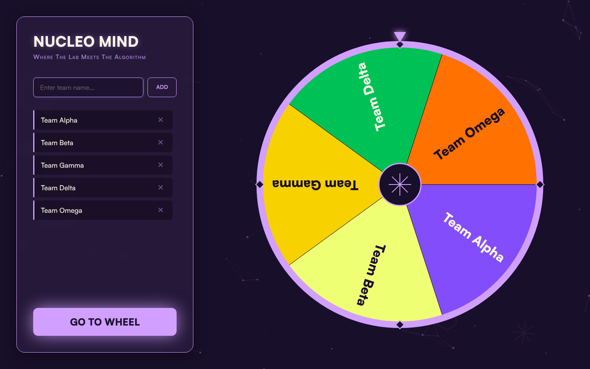

# Nucleo Mind : roue de tirage au sort

Roue animée de tirage au sort entre équipes, réalisée pour répartir les sujets du hackathon **Nucleo Mind**, organisé par Project Initiative à l'USTHB.


**Démo en ligne :** [nucleomind-sable.vercel.app](https://nucleomind-sable.vercel.app)



## Fonctionnement

1. On saisit le nom des équipes. La liste est enregistrée dans le navigateur (`localStorage`) et survit à un rechargement de la page.
2. Le bouton **Go to wheel** passe en mode présentation, centré sur la roue.
3. **Spin** lance la roue. Une fenêtre affiche l'équipe tirée.
4. Le segment de l'équipe tirée éclate en morceaux, et les segments restants s'élargissent pour combler la place.
5. On recommence jusqu'à ce que toutes les équipes soient passées.

## Technique

Un seul fichier `index.html`, sans bibliothèque ni étape de build :

- roue, pointeur et décor dessinés sur un `<canvas>`, redimensionnés selon la fenêtre ;
- boucle d'animation avec `requestAnimationFrame` et courbes d'accélération (*easing*) pour la rotation, l'éclatement et la réorganisation des segments ;
- chaque segment garde son angle de départ et son angle cible, ce qui permet d'interpoler la transition quand une équipe est retirée.

## Lancer en local

```bash
git clone https://github.com/medazero01-art/roulettepi.git
cd roulettepi
# ouvrir index.html dans un navigateur
```

## Auteur

**Ayoub Touat** · [@medazero01-art](https://github.com/medazero01-art)
